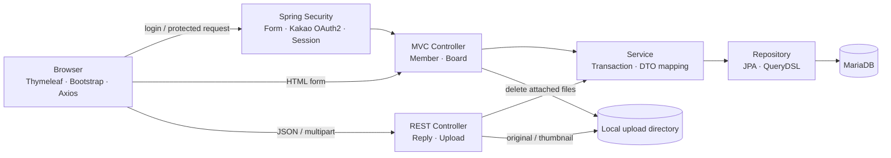

# MarketWatcher

<p align="center">
  
</p>

<p align="center">
  시장 정보를 함께 보고 토론하는 서비스로 확장 중인 Spring Boot 커뮤니티 플랫폼
</p>

<p align="center">
  
  
  
  
</p>

## 프로젝트 소개

MarketWatcher는 회원 인증, 게시글, 이미지 첨부, 댓글을 하나의 흐름으로 구현한 서버 사이드 렌더링 웹 애플리케이션입니다. 폼 로그인과 Kakao OAuth2 로그인, 작성자 권한 확인, 동적 검색과 페이지네이션, REST 댓글 API, 이미지 썸네일 생성까지 웹 서비스의 기본 구조를 직접 구성했습니다.

현재 버전은 **시장 데이터를 다루기 위한 커뮤니티 기반 기능**에 초점을 맞추고 있습니다. 실시간 시세 수집, 관심 종목, 가격 알림은 아직 구현되지 않았으며 [Roadmap](#roadmap)의 다음 단계로 계획하고 있습니다.

## 무엇을 구축했나요?

| 영역 | 구현 내용 |
| --- | --- |
| 회원 | 회원가입, 아이디 중복 확인, BCrypt 비밀번호 암호화, 비밀번호 변경, `USER` 역할 부여 |
| 인증 | Spring Security 폼 로그인, Kakao OAuth2 로그인, 세션 인증, JDBC 기반 30일 remember-me, 커스텀 403 처리 |
| 게시글 | 등록·목록·상세·수정·삭제, 작성자 기반 수정·삭제 권한, Bean Validation |
| 검색 | 제목·내용·작성자 조합 검색, QueryDSL 동적 쿼리, 페이지네이션, 댓글 수 집계 |
| 파일 | 다중 파일 업로드, UUID 파일명, 이미지 판별, 200×200 썸네일 생성, 원본·썸네일 삭제 |
| 댓글 | Axios 기반 비동기 UI, REST 방식 등록·조회·수정·삭제, 게시글별 페이지네이션 |
| 문서화 | Springdoc OpenAPI와 로컬 Swagger UI, 인증·업로드 처리 흐름 문서 |
| 환경 분리 | `local`/`prod` 프로필, `.env` 기반 로컬 설정, 운영 세션 쿠키·오류 응답 보안 설정 |

## 기술 스택

### Backend

- Java 17, Gradle Wrapper
- Spring Boot 3.5.14
- Spring MVC, Spring Validation
- Spring Data JPA, Hibernate, QueryDSL 5.1.0
- Spring Security, OAuth2 Client
- MariaDB
- Lombok, ModelMapper
- Thumbnailator
- Springdoc OpenAPI

### Frontend

- Thymeleaf, Thymeleaf Layout Dialect
- Bootstrap 5
- Vanilla JavaScript, Axios

### Test

- JUnit 5
- Spring Boot Test

## Workflow



### 사용자 흐름

1. 사용자는 일반 회원가입 또는 Kakao OAuth2로 로그인합니다.
2. Spring Security가 인증 정보를 세션에 저장하고, remember-me를 선택하면 토큰을 DB에 보관합니다.
3. 게시글 목록에서 제목·내용·작성자 기준으로 검색하고 페이지를 이동합니다.
4. `USER` 권한을 가진 사용자는 글을 작성합니다. 첨부 파일은 먼저 `/upload`로 전송됩니다.
5. 서버는 파일을 `UUID_원본파일명`으로 저장하고, 이미지라면 `s_` 접두사의 200×200 썸네일을 생성합니다.
6. 글을 저장할 때 파일 식별자를 게시글 이미지 메타데이터와 연결합니다.
7. 상세 화면에서는 첨부 이미지와 댓글을 조회합니다. 댓글 작업은 Axios가 REST API를 호출합니다.
8. 게시글 작성자는 자신의 글을 수정하거나 삭제할 수 있으며, 삭제 시 연결된 이미지 메타데이터와 파일도 함께 정리됩니다.

## 시작하기

### 1. 준비 사항

- JDK 17
- MariaDB
- Kakao 로그인을 사용할 경우 Kakao Developers 애플리케이션

Gradle은 Wrapper가 포함되어 있어 별도로 설치할 필요가 없습니다.

### 2. 로컬 환경변수 설정

프로젝트 루트에서 예제 파일을 복사합니다.

```powershell
Copy-Item .env.example .env
```

macOS/Linux에서는 다음 명령을 사용합니다.

```bash
cp .env.example .env
```

`.env`의 값을 로컬 환경에 맞게 수정합니다. 실제 `.env`는 Git에 커밋하지 마세요.

| 변수 | 설명 | 예시 |
| --- | --- | --- |
| `DB_URL` | MariaDB JDBC URL | `jdbc:mariadb://localhost:3309/webdb` |
| `DB_USERNAME` | DB 사용자 | `webuser` |
| `DB_PASSWORD` | DB 비밀번호 | 로컬에서 설정한 비밀번호 |
| `KAKAO_CLIENT_ID` | Kakao REST API 키 | Kakao Developers에서 발급 |
| `KAKAO_CLIENT_SECRET` | Kakao Client Secret | Kakao Developers에서 발급 |
| `REMEMBER_ME_KEY` | remember-me 토큰 서명 키 | 예측하기 어려운 32바이트 이상의 값 |
| `UPLOAD_PATH` | 업로드 파일 저장 경로 | `C:/marketwatcher/upload` |

`UPLOAD_PATH`는 애플리케이션이 자동으로 만들지 않으므로 먼저 생성해야 합니다.

```powershell
New-Item -ItemType Directory -Force C:\marketwatcher\upload
```

### 3. 데이터베이스 준비

아래는 `.env.example`과 같은 이름을 사용할 때의 예시입니다. 비밀번호와 포트는 자신의 환경에 맞게 변경하세요.

```sql
CREATE DATABASE webdb
  CHARACTER SET utf8mb4
  COLLATE utf8mb4_unicode_ci;

CREATE USER 'webuser'@'localhost' IDENTIFIED BY 'your-password';
GRANT ALL PRIVILEGES ON webdb.* TO 'webuser'@'localhost';
FLUSH PRIVILEGES;
```

로컬 프로필은 `spring.jpa.hibernate.ddl-auto=update`를 사용하므로 JPA 엔티티 테이블을 생성하거나 갱신합니다. remember-me 기능이 사용하는 테이블은 JPA 엔티티가 아니므로 별도로 생성해야 합니다.

```sql
USE webdb;

CREATE TABLE persistent_logins (
    username  VARCHAR(64) NOT NULL,
    series    VARCHAR(64) PRIMARY KEY,
    token     VARCHAR(64) NOT NULL,
    last_used TIMESTAMP NOT NULL
);
```

### 4. Kakao 로그인 설정

Kakao Developers 애플리케이션에 다음 Redirect URI를 등록합니다.

```text
http://localhost:8080/login/oauth2/code/kakao
```

프로젝트는 `profile_nickname`, `account_email` 동의를 요청하며, 현재 소셜 회원 식별에 이메일을 사용하므로 이메일 제공 동의가 필요합니다.

Kakao 로그인을 사용하지 않더라도 애플리케이션 시작에 필요한 placeholder를 해석할 수 있도록 `.env`의 Kakao 관련 값은 채워 두어야 합니다.

### 5. 실행

Windows:

```powershell
.\gradlew.bat bootRun
```

macOS/Linux:

```bash
./gradlew bootRun
```

실행 후 [http://localhost:8080/board/list](http://localhost:8080/board/list)로 접속합니다.

## 주요 화면과 API

### Web

| Method | URL | 설명 |
| --- | --- | --- |
| `GET` | `/board/list` | 게시글 목록, 검색, 페이지네이션 |
| `GET`, `POST` | `/member/join` | 회원가입 |
| `GET`, `POST` | `/member/login` | 폼 로그인 |
| `GET` | `/oauth2/authorization/kakao` | Kakao 로그인 시작 |
| `GET`, `POST` | `/board/register` | 게시글 등록 |
| `GET` | `/board/read?bno={id}` | 게시글 상세 |
| `GET`, `POST` | `/board/modify?bno={id}` | 게시글 수정 |
| `POST` | `/board/remove` | 게시글 삭제 |

### REST

| Method | URL | 설명 |
| --- | --- | --- |
| `POST` | `/replies/` | 댓글 등록 |
| `GET` | `/replies/list/{bno}` | 게시글의 댓글 목록 |
| `GET`, `PUT`, `DELETE` | `/replies/{rno}` | 댓글 조회·수정·삭제 |
| `POST` | `/upload` | multipart 파일 업로드 |
| `GET` | `/view/{fileName}` | 업로드 파일 조회 |
| `DELETE` | `/remove/{fileName}` | 업로드 파일 삭제 |

로컬 프로필에서는 다음 API 문서를 확인할 수 있습니다.

- Swagger UI: [http://localhost:8080/swagger-ui/index.html](http://localhost:8080/swagger-ui/index.html)
- OpenAPI JSON: [http://localhost:8080/v3/api-docs](http://localhost:8080/v3/api-docs)

운영 프로필에서는 Swagger UI와 OpenAPI JSON이 비활성화됩니다.

## 프로젝트 구조

```text
marketwatcher/
├── src/main/java/com/stock/marketwatcher/
│   ├── config/          # Security, ModelMapper, OpenAPI 설정
│   ├── controller/      # MVC 및 REST 진입점
│   ├── domain/          # JPA Entity
│   ├── dto/             # 화면/API 데이터 전달 객체
│   ├── repository/      # Spring Data JPA, QueryDSL
│   ├── security/        # 폼·OAuth2 사용자 로딩과 인증 핸들러
│   └── service/         # 비즈니스 로직과 트랜잭션
├── src/main/resources/
│   ├── templates/       # Thymeleaf 화면
│   ├── static/          # CSS, JavaScript, 이미지
│   └── application*.properties
├── src/test/            # Repository, Service, Controller 테스트
├── docs/                # 인증·파일 처리 흐름 문서
├── .env.example
└── build.gradle
```

## 빌드와 테스트

```powershell
# 테스트
.\gradlew.bat test

# 테스트를 포함한 전체 빌드
.\gradlew.bat clean build

# 테스트를 제외한 패키징
.\gradlew.bat clean build -x test
```

> [!CAUTION]
> 현재 여러 테스트는 별도의 테스트 DB가 아니라 설정된 MariaDB에 연결해 데이터를 등록·수정·삭제하며, 일부 고정 ID를 전제로 합니다. 운영 DB를 연결한 상태에서는 테스트를 실행하지 마세요. 테스트 전용 DB를 사용하고 필요한 데이터를 먼저 확인해야 합니다.

빌드 결과는 `build/libs/marketwatcher-0.0.1-SNAPSHOT.jar`에 생성됩니다.

```powershell
java -jar build/libs/marketwatcher-0.0.1-SNAPSHOT.jar
```

운영 환경에서는 모든 설정을 환경변수나 Secret으로 주입하고 `SPRING_PROFILES_ACTIVE=prod`를 설정합니다. `prod` 프로필은 DB 스키마를 자동 변경하지 않고 검증만 하므로 배포 전에 스키마가 준비되어 있어야 합니다.

## Roadmap

### 1. 보안과 정확성

- [ ] 댓글 등록 응답이 실제 생성된 댓글 번호를 반환하도록 수정
- [ ] 게시글·댓글·업로드 API의 인증과 소유권 정책을 일관되게 적용
- [ ] 업로드 파일의 확장자·MIME·경로 검증과 저장 용량 제한 강화
- [ ] OAuth2 회원을 이메일이 아닌 provider와 provider user id 조합으로 식별
- [ ] 회원가입 입력 검증과 민감정보 로그 정책 강화

### 2. 테스트와 운영 자동화

- [ ] Flyway 또는 Liquibase로 스키마와 `persistent_logins` 테이블 버전 관리
- [ ] Testcontainers와 테스트 프로필로 MariaDB 통합 테스트 격리
- [ ] GitHub Actions에서 빌드·테스트 자동화
- [ ] Docker Compose로 애플리케이션과 MariaDB 개발 환경 제공
- [ ] 파일을 S3 호환 Object Storage로 이전

### 3. MarketWatcher 도메인

- [ ] 종목(`Ticker`)과 관심 목록(`Watchlist`) 모델 추가
- [ ] 외부 시장 데이터 API 연동과 시세 스냅샷 적재
- [ ] 가격·등락률 조건 알림
- [ ] 종목별 게시글 연결과 대시보드 시각화
- [ ] 배치 수집 실패 재시도, rate limit, 데이터 최신성 모니터링

### 추천 개발 순서

1. 댓글 응답 오류와 API 권한을 먼저 정리해 현재 기능의 신뢰성을 높입니다.
2. DB 마이그레이션과 격리된 테스트 환경을 만들어 변경 가능한 기반을 마련합니다.
3. `Ticker → Watchlist → QuoteSnapshot → Alert` 순서로 시장 도메인을 추가합니다.
4. CI, 컨테이너, Object Storage를 연결한 뒤 공개 데모를 배포합니다.

## 관련 문서

- [게시글 업로드 메커니즘](./docs/board-upload-mechanism.png)
- [게시글 이미지 연관관계](./docs/board-image-mechanism.png)
- [파일 업로드·삭제 흐름](./docs/file-upload-delete-mechanism.png)
- [Spring Security 요청 흐름](./spring-security-request-journey.html)
