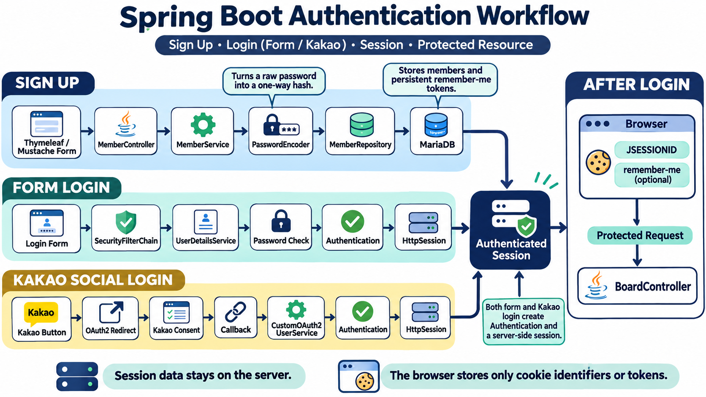

# Guidebook Plan: Sign-Up and Login with Spring Boot Sessions

## Working title

**Build Sign-Up and Login You Can Adapt**  
Spring Boot 3, Spring Security 6, HTTP sessions, cookies, remember-me, Kakao OAuth2, and server-rendered templates

## Book promise

This book will take a beginner from an empty authentication feature to a working, testable sign-up and login system. It will use this `marketwatcher` project as the continuous example instead of presenting disconnected code fragments.

The main implementation will use Thymeleaf. Short “Mustache adaptation” sections will show that the controller, service, repository, security, session, and OAuth2 code remain the same; only view rendering and CSRF-field syntax change.

The target length is **120 pages**. That is long enough for line-by-line explanation and request tracing, while still excluding large adjacent topics such as JWT APIs, microservices, MFA, and a complete account-recovery product.

## Major workflow



The image introduces the book’s central rule:

- Sign-up stores a safe member record; it does not authenticate the browser by itself.
- Form login and Kakao login are different ways to produce a trusted `Authentication`.
- Spring Security associates that authentication with an `HttpSession`.
- The browser normally stores a `JSESSIONID` cookie, not the Java `Member` object.
- Persistent remember-me is an optional second login mechanism and has its own cookie and database token.

## Scope

### Included

- Spring Boot MVC and Spring Security filter-chain basics
- Member entity, request DTO, validation, service, repository, and password hashing
- Thymeleaf sign-up, login, logout, error, and authenticated navigation
- Mustache equivalents for the view-specific pieces
- Form login with `UserDetailsService`
- `SecurityContext`, `Authentication`, `HttpSession`, and `JSESSIONID`
- Cookie flags and logout behavior
- Persistent remember-me using `persistent_logins`
- Kakao OAuth2 authorization-code login
- Safe social-member creation and provider identity linking
- CSRF, authorization rules, input validation, mass-assignment prevention, and secret management
- Controller, service, repository, security, and browser-flow tests
- Local and production configuration boundaries

### Deliberately excluded from the core book

- JWT resource servers
- SPA/mobile authentication
- SAML and enterprise identity providers
- Multi-factor authentication
- Full password-reset email delivery
- Full account deletion and compliance workflows
- Multi-tenant authorization

These can be follow-up volumes. Mentioning them briefly is useful; implementing them would make this beginner book too broad.

## Reader prerequisites

- Basic Java classes, interfaces, constructors, and exceptions
- Basic HTML forms
- Very basic SQL understanding
- Ability to run a Spring Boot application and MariaDB locally

No prior Spring Security or OAuth2 knowledge is assumed.

## Final application behavior

By the end, a reader can:

1. Register a local account with validated input and a one-way encoded password.
2. Log in with username and password.
3. Understand why a successful login creates server-side session state and a browser cookie.
4. Log out with a CSRF-protected POST request.
5. Optionally stay signed in through a revocable persistent remember-me token.
6. Log in through Kakao without inventing a shared local password.
7. Keep a Kakao identity separate from an unverified matching email address.
8. Protect URLs and method calls according to roles.
9. render the same feature with Thymeleaf or Mustache.
10. Test success, failure, attack, and logout paths before deployment.

## Page plan: 120 pages

| Pages | Chapter | Outcome | Main project artifacts | Required illustration or lab |
|---:|---|---|---|---|
| 1–4 | 1. What We Are Building | See the final browser journey and vocabulary | Entire authentication slice | Major workflow image and final-page tour |
| 5–12 | 2. One HTTP Request at a Time | Understand browser, controller, response, cookie, and database roles | `MemberController`, browser devtools | Request/response timeline |
| 13–20 | 3. Project Setup and Layers | Run the project and understand dependencies and packages | `build.gradle`, application profiles | Dependency map and package tree |
| 21–28 | 4. Design the Member Model | Model local and social identities without trusting form fields | `Member`, `MemberRole`, planned `OAuthIdentity` | Entity relationship diagram |
| 29–38 | 5. Build a Safe Sign-Up Request | Bind only intended fields and validate them | restricted `MemberJoinDTO`, validation annotations | Good request versus mass assignment |
| 39–48 | 6. Implement Sign-Up End to End | Trace form → controller → service → repository → database | `join.html`, `MemberController`, `MemberServiceImpl`, `MemberRepository` | Sequence diagram and SQL inspection |
| 49–54 | 7. Hash Passwords Correctly | Understand encoding versus encryption and matching | `PasswordEncoderConfiguration`, `PasswordEncoder` | Raw password/hash comparison |
| 55–64 | 8. Configure Form Login | Build the filter chain and public/protected routes | `CustomSecurityConfig`, `login.html` | Filter-chain diagram |
| 65–72 | 9. Load a Member for Authentication | Turn a database member into `UserDetails` | `CustomUserDetailsService`, `MemberSecurityDTO` | Method-call trace |
| 73–80 | 10. Sessions and `JSESSIONID` | Inspect authentication before and after login | `SecurityContext`, `HttpSession` | Browser/server state split |
| 81–86 | 11. Logout, CSRF, and Session Expiry | End a session safely and explain 403 failures | logout form in shared layout, security config | CSRF request comparison |
| 87–94 | 12. Remember-Me Cookies | Add revocable long-lived login without confusing it with a session | `PersistentTokenRepository`, `persistent_logins` | Session-cookie versus remember-me timeline |
| 95–104 | 13. Kakao OAuth2 Login | Follow authorization redirect, consent, callback, and user-info request | `application.properties`, `CustomOAuth2UserService` | OAuth2 authorization-code sequence |
| 105–110 | 14. Create and Link Social Members Safely | Store provider identity, avoid `1111`, and handle first login | `OAuthIdentity`, repository, OAuth service, success handler | First login versus returning login |
| 111–114 | 15. Thymeleaf and Mustache Adaptation | Switch view engines without rewriting authentication logic | paired small templates | Syntax comparison table |
| 115–118 | 16. Security and Test Checklist | Prove happy and hostile paths | MockMvc, service tests, repository tests | Test pyramid and attack labs |
| 119–120 | 17. Deployment Readiness | Externalize secrets and choose production cookie settings | `.env.example`, prod profile | Local versus cloud configuration |

## Repeated teaching pattern for every implementation chapter

Every chapter that adds code follows the same eight-step pattern:

1. **User action** — what the person does in the browser.
2. **HTTP message** — method, URL, form fields, cookies, and expected status.
3. **Class responsibility** — why this class owns this step.
4. **Small code set** — one complete, compilable change.
5. **Line-by-line explanation** — annotations, parameters, return values, and injected dependencies.
6. **Method interaction trace** — caller, callee, returned value, and state change.
7. **Run and inspect** — application log, browser devtools, and SQL query.
8. **Failure lab** — intentionally break one condition and learn from the status or exception.

This pattern keeps the book practical without dumping an entire finished application on the reader.

## Sequential implementation path

### Step 1: Establish the dependency and configuration boundary

Start with the dependencies already present in `build.gradle`:

- Spring Web
- Spring Data JPA
- Spring Security
- OAuth2 Client
- Validation
- Thymeleaf and its Spring Security extras
- MariaDB

Explain that Mustache is an alternative view dependency. The book should provide either a small branch or an appendix patch for replacing the Thymeleaf dependency; readers should not run both engines without a clear reason.

Configuration is split into:

- `application.properties`: shared, non-secret names and OAuth2 structure
- `application-local.properties`: local database and developer behavior
- `application-prod.properties`: production-safe behavior
- `.env`: ignored local secrets
- cloud environment variables: production secrets

### Step 2: Correct the domain boundary before building the form

`Member` is persistent server-owned state. A sign-up request must not be allowed to set `del`, `social`, or roles.

The sign-up DTO should contain only user-editable input such as:

```java
public class MemberJoinDTO {
    private String mid;
    private String mpw;
    private String email;
}
```

The book then adds validation constraints and explains each error message. `social=false`, `del=false`, and `USER` are assigned in service/domain code.

### Step 3: Add `PasswordEncoderConfiguration`

Create one bean and inject the interface everywhere:

```java
@Configuration
public class PasswordEncoderConfiguration {

    @Bean
    public PasswordEncoder passwordEncoder() {
        return PasswordEncoderFactories.createDelegatingPasswordEncoder();
    }
}
```

Explain why configuration creates infrastructure and why services consume it. Demonstrate `encode(raw)` for storage and `matches(raw, encoded)` for authentication. Never decode or log passwords.

### Step 4: Complete local sign-up

Build the feature in this order:

1. `GET /member/join` renders a blank form.
2. Thymeleaf binds fields and displays validation errors.
3. `POST /member/join` accepts `@Valid MemberJoinDTO` and `BindingResult`.
4. `MemberService.join` checks uniqueness and assigns safe server-owned defaults.
5. `PasswordEncoder` hashes the password.
6. `MemberRepository.save` persists the member and `USER` role.
7. Success redirects to `/member/login`; validation returns the form.

The current `ModelMapper` path should be replaced or constrained so it cannot copy security-sensitive fields. The current `log.info(memberJoinDTO)` must also be removed because it can expose the raw password.

### Step 5: Configure URL authorization and form login

Teach the minimum explicit policy:

- public: static assets, join page, join submission, login page, OAuth2 endpoints
- authenticated: board writing and member modification
- role-restricted: administrative URLs, if present
- everything else: choose intentionally rather than relying on defaults

Then configure:

- custom login page
- login processing URL
- success and failure destinations
- POST logout
- access-denied handler

The password input in the current login page must change from `type="text"` to `type="password"`.

### Step 6: Connect form login to the database

Explain the exact interaction:

```text
UsernamePasswordAuthenticationFilter
    -> AuthenticationManager
        -> DaoAuthenticationProvider
            -> CustomUserDetailsService.loadUserByUsername(mid)
                -> MemberRepository.getWithRoles(mid)
                    -> MemberSecurityDTO
            -> PasswordEncoder.matches(raw, storedHash)
```

`MemberSecurityDTO` should accurately expose enabled/deleted state. A deleted member must not remain enabled merely because the three-argument `User` constructor defaults to enabled.

### Step 7: Make the session visible

After form login, show:

- `Authentication` in the `SecurityContext`
- the context stored through the security context repository
- the server-side `HttpSession`
- `Set-Cookie: JSESSIONID=...`
- the browser returning that cookie on the next protected request

The reader should test three requests: before login, immediately after login, and after logout/session expiry.

### Step 8: Add logout and CSRF correctly

Place the logout form in the shared authenticated navigation, not in a separate `logout.html` unless a product actually needs a logout confirmation page.

Thymeleaf example:

```html
<form th:action="@{/member/logout}" method="post">
    <button type="submit">Logout</button>
</form>
```

The chapter explains how Thymeleaf/Spring Security contributes the CSRF field and how to verify it in rendered HTML. The Mustache version explicitly renders the token made available to the template. GET logout is not used.

### Step 9: Add persistent remember-me as an optional mechanism

Distinguish two lifetimes:

- `JSESSIONID`: points to the current server session.
- `remember-me`: lets Spring authenticate a returning browser after the session has gone.

Teach `persistent_logins`, the persistent token repository, token rotation, logout cleanup, `HttpOnly`, `Secure`, and `SameSite`. The local and production behavior must be tested separately because HTTPS changes cookie requirements.

### Step 10: Add Kakao OAuth2 login

Trace the exact endpoints:

1. `/oauth2/authorization/kakao`
2. Kakao authorization endpoint
3. `{baseUrl}/login/oauth2/code/kakao`
4. Kakao token endpoint
5. Kakao user-info endpoint
6. `CustomOAuth2UserService.loadUser`
7. authenticated session and redirect

Explain every registration property and why the redirect URI must match Kakao’s developer-console configuration.

### Step 11: Replace the shared `1111` social password pattern

The current first-login branch creates a social member with an encoded `1111`, and `CustomSocialLoginHandler` detects that sentinel. The book should replace that block, not add a second member-creation block.

Core correction:

- Identify the Kakao account by provider plus provider subject (`kakao` + Kakao `id`).
- Keep provider identity in a separate `OAuthIdentity` record or an equivalent unique key.
- If the existing schema requires `mpw`, store an unusable random encoded value; never show it and never use it as a completion flag.
- Store profile-completion state explicitly if the application needs an onboarding screen.
- Do not silently link a local account only because Kakao reports the same email.
- Remove `passwordEncoder.matches("1111", ...)` from the success handler.

This chapter contains two paths: a minimal safe patch for the current schema and a recommended provider-identity model.

### Step 12: Keep template-engine differences at the edge

The controller endpoints, DTO validation, service, repository, security filters, session, cookies, and OAuth2 flow do not change.

Only these examples need paired versions:

- form action URL
- field value and validation error rendering
- CSRF hidden field
- authenticated/anonymous navigation fragments
- current principal display

This proves that authentication is not a Thymeleaf feature or a Mustache feature; the templates are views over the same server-side mechanism.

### Step 13: Test the mechanism, not only the page

Required tests:

- sign-up accepts valid input and stores an encoded password
- sign-up rejects blank/invalid input
- direct request cannot assign `social`, `del`, or roles
- duplicate ID is rejected
- form login succeeds and fails correctly
- protected URL redirects an anonymous browser
- authenticated session can access protected URL
- CSRF-less POST is rejected
- logout invalidates the session and cookies as configured
- remember-me authenticates after the session disappears
- OAuth2 first login creates exactly one social identity
- OAuth2 returning login reuses that identity
- unverified matching email does not take over a local account
- deleted/disabled member cannot authenticate

### Step 14: Finish with deployment-safe settings

The final checklist covers:

- secrets absent from Git and logs
- rotated Kakao secret
- exact production redirect URI
- HTTPS and secure cookies
- production schema validation/migrations
- safe error responses
- reduced security logging
- database backup and least-privilege database user

## Project class interaction map

| Layer | Local sign-up | Form login | Kakao login | Session/remember-me |
|---|---|---|---|---|
| View | `member/join.html` | `member/login.html` | Kakao link on login page | shared logout/navigation fragment |
| Controller/Filter | `MemberController` | Spring Security form filter | OAuth2 authorization and callback filters | logout, security-context, remember-me filters |
| Service | `MemberServiceImpl` | `CustomUserDetailsService` | `CustomOAuth2UserService` | Spring Security session and remember-me services |
| DTO/Principal | restricted `MemberJoinDTO` | `MemberSecurityDTO` | `MemberSecurityDTO` plus OAuth attributes | `Authentication` |
| Repository | `MemberRepository` | `MemberRepository.getWithRoles` | member and provider-identity repositories | `PersistentTokenRepository` |
| Storage | `member`, role collection | member password hash and roles | member plus OAuth identity | server session plus `persistent_logins` |

## Illustration set for the full book

The final book should contain approximately 18 focused illustrations:

1. Major authentication workflow
2. Browser/server/database responsibility split
3. Package/layer map
4. Safe DTO boundary versus entity mass assignment
5. Sign-up sequence
6. Password encode/match lifecycle
7. Spring Security filter-chain position
8. Form-login method call stack
9. `Authentication` object anatomy
10. Session creation timeline
11. Cookie round trip
12. CSRF attacker/request comparison
13. Logout/session invalidation
14. Remember-me recovery after session expiry
15. Kakao authorization-code sequence
16. Local member versus OAuth identity relationship
17. First social login versus returning social login
18. Local versus production configuration

Each image should teach one relationship. Screenshots should be used only for browser devtools, SQL inspection, Kakao console settings, and expected error pages.

## Code-sample rules

- Every code set must compile at the end of its chapter.
- New lines are shown in context, not as unexplained fragments.
- Secrets use placeholders and environment variables.
- Passwords and OAuth tokens never appear in logs or screenshots.
- Security-sensitive defaults are assigned by server code.
- Each annotation is explained the first time it appears.
- A code listing longer than one page is split by responsibility.
- Thymeleaf is the complete path; Mustache listings show only the view differences.
- The Git tag or commit for each chapter should be named so readers can compare stages.

## Suggested repository deliverables

```text
docs/auth-guide/
  manuscript/
    01-what-we-are-building.md
    02-http-requests.md
    ...
    17-deployment-readiness.md
  images/
  labs/
  answers/
  code-checkpoints.md
```

Suggested checkpoint tags:

```text
auth-book/ch03-start
auth-book/ch06-signup-complete
auth-book/ch09-form-login-complete
auth-book/ch12-remember-me-complete
auth-book/ch14-social-login-complete
auth-book/ch17-production-ready
```

## Definition of done for the manuscript

The guidebook is ready when:

- the page count is 110–125 pages after rendering;
- a new reader can follow it from a clean database;
- every chapter ends in a runnable state;
- all code examples are covered by a compile or test checkpoint;
- both Thymeleaf and Mustache views are demonstrated without duplicating business logic;
- the final project contains no shared social password, trusted client security flags, plaintext secret, or password logging;
- the reader can explain the difference among an `Authentication`, `HttpSession`, `JSESSIONID`, persistent remember-me cookie, and Kakao OAuth2 authorization.

## Recommended writing order

Write and verify the guide in four batches:

1. **Pages 1–48:** mental model, domain boundary, validation, and sign-up.
2. **Pages 49–94:** password encoding, form login, sessions, logout, and remember-me.
3. **Pages 95–114:** Kakao login, safe identity linking, and template adaptation.
4. **Pages 115–120:** tests, security checklist, deployment, and final consistency edit.

The first usable milestone is the end of batch 1. The first complete local authentication system is the end of batch 2. Social login is then added to a system whose session and security boundaries the reader already understands.
